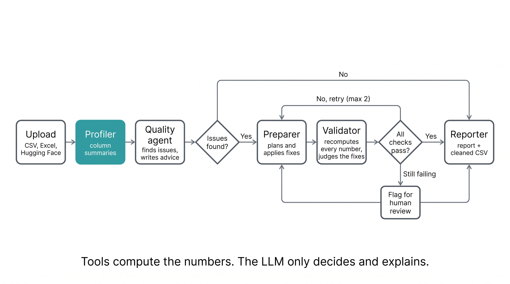
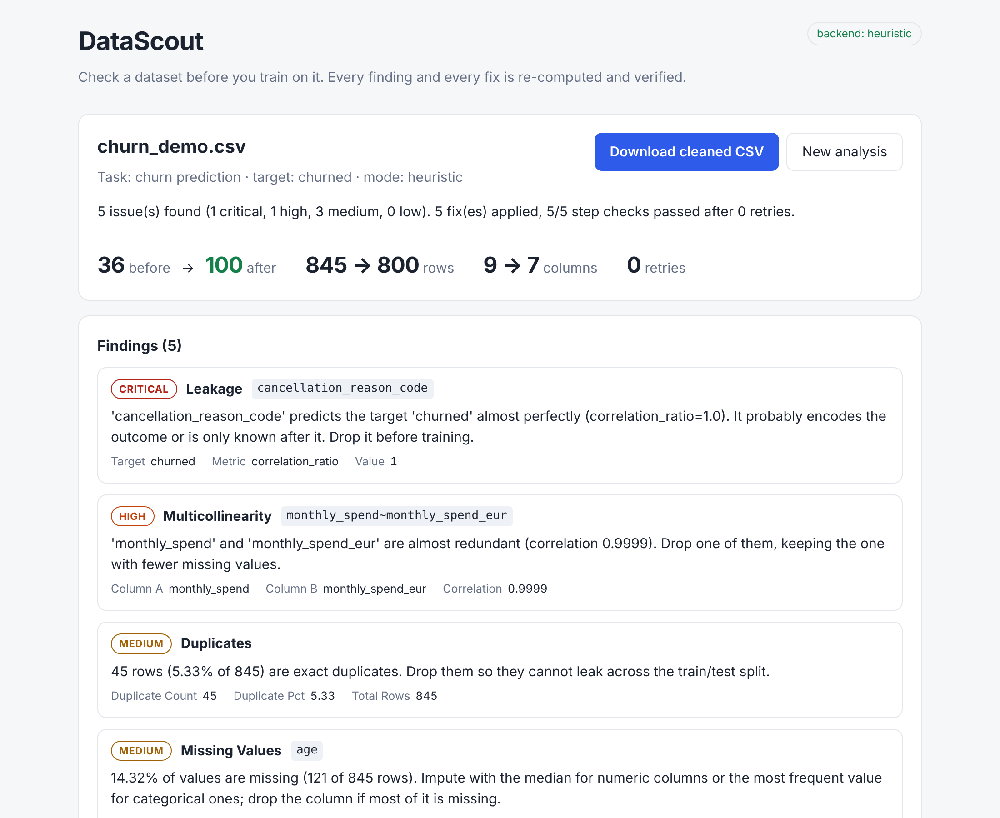

# DataScout

[](https://github.com/Ahmad1234Mehmood/datascout/actions/workflows/eval.yml)

An agent that checks a dataset before you train a model on it. It profiles the data, detects quality problems, applies
fixes, **re-computes every number it reports to verify it**, and returns a structured report with a cleaned dataset.
It can also compare two datasets for distribution drift.





## Features

| Check | Detection | Action |
|---|---|---|
| Missing values | share per column, flagged at ≥ 1% | median / mode imputation, drop rows or column |
| Outliers | 3×IQR fences (log scale for the upper fence of right-skewed data) | clip to the fences |
| Target leakage | correlation ratio, Pearson or category purity ≥ 0.99 with the target | drop the column |
| Class imbalance | minority class < 20% | advice only |
| Duplicates | exact duplicate rows ≥ 1% | drop |
| Multicollinearity | \|r\| ≥ 0.95 between numeric features | drop one of the pair |
| Constant columns | at most one distinct value | drop |
| Distribution drift | KS test (numeric) or chi-square (categorical) between two datasets | advice only |

Blank strings are treated as missing and all-numeric text columns are converted on load; every change is listed in the report.

## Quick start

```bash
python -m venv .venv && source .venv/bin/activate     # Windows: .venv\Scripts\activate
pip install -r requirements.txt
pytest -q
uvicorn datascout.api.app:app --reload                # API on :8000, docs at /docs
cd frontend && npm install && npm run dev             # UI on :5173
```

Try `examples/churn_demo.csv` with task `churn prediction` and target `churned`.

## Usage

```python
from datascout.agents.graph import analyze_file
report, clean = analyze_file("data.csv", "churn prediction", "churned")
```

```bash
python scripts/analyze_csv.py data.csv "churn prediction" churned
python scripts/analyze_csv.py hf:scikit-learn/churn-prediction "churn prediction" <target>   # needs: pip install datasets
python scripts/check_drift.py reference.csv current.csv
```

**REST API:** `POST /analyze` returns a job id; then `GET /jobs/{id}`, `GET /report/{id}`, `GET /download/{id}`.
Also `POST /analyze_hf` and `POST /drift`.

**MCP server:** `python -m datascout.mcp_server.server` exposes `profile_dataset`, `check_quality`, `check_leakage`,
`compute_stats`, `check_drift` and `prepare_data`. File access is limited to the folder set in `DATASCOUT_MCP_ROOT`.

## LLM mode

By default DataScout runs rule-based, with no model. Set `DATASCOUT_LLM_PROVIDER` to `ollama`, `openai` (any
OpenAI-compatible endpoint) or `anthropic` in `.env` (see `.env.example`) and a model plans the checks, proposes the
fixes, writes the advice and judges each fix. Detection and all numbers remain computed by code.

To run a model on a free Kaggle GPU: upload `notebooks/ollama_server_kaggle_colab.ipynb`, set Accelerator to GPU and
Internet to On, run all cells, copy the three printed lines into `.env`, then run `python scripts/check_llm.py`.
The tunnel URL has no authentication; do not share it. Optional Langfuse tracing: set `LANGFUSE_PUBLIC_KEY`,
`LANGFUSE_SECRET_KEY` and `LANGFUSE_HOST`.

## Design

- **Tools compute, the model decides.** The model sees column profiles, never raw rows, and no number it writes reaches
  the report unverified.
- **Independent validation.** Separate code recomputes every finding, checks every fix on the cleaned data (target kept,
  at least 50% of rows kept, no new missing values) and checks that numbers in advice appear in the evidence.
- **Retry, then escalate.** A failed check restarts from the original data with a safer strategy (maximum two retries),
  then the run is flagged for human review.
- **Bounded model influence.** Dataset-level checks always run, checks the model skips are added and reported, and a
  judge-only objection costs at most one retry.
- **Graceful degradation.** Invalid model output is retried with backoff, then the rule-based client takes over and the
  report says so.
- **Class imbalance is advisory.** Resampling before the train/test split leaks information.

## Evaluation

26 datasets built by `evaluation/make_golden.py`, with ground truth from the injected issues: 13 single-issue, 3 mixed,
6 synthetic hard negatives and 4 real scikit-learn datasets. CI fails if precision, recall or the false-positive rule drop.

| | Rule-based | LLM mode (qwen2.5:7b) |
|---|---|---|
| Injected issues found | 28 / 28 | 28 / 28 |
| False positives | 0 | 0 |
| Pipeline success | 26 / 26 | 25 / 26 |
| Fix steps rejected by the LLM judge | n/a | 1 / 25 |
| Rule-based fallbacks | n/a | 0 |
| Column checks added by the safety net | n/a | 191 |
| Advice repaired by the grounding check | n/a | 2 |

- LLM results are a single run through Ollama on a Kaggle GPU. Detection is computed by the tools, so precision and recall
  reflect the tools; the last four rows describe the model's behaviour.
- **Real data:** on the Telco churn dataset (7043 rows) the first run missed `TotalCharges` stored as text with blank
  values. This is fixed; see [docs/REAL_DATA.md](docs/REAL_DATA.md).
- **Drift:** on random splits of real datasets, 2 false alarms in 400 comparisons; a +0.5 standard deviation shift was
  detected in 281 of 400. Detection power depends on sample size.
- The test sets were written together with the detectors, and some rules were adjusted after failures, so results are
  not a held-out benchmark. LLM-mode logs are in [docs/results](docs/results).

## Limitations

- Imputation and clipping use the whole dataset; in a training pipeline, fit them on the training split.
- Leakage detection finds near-deterministic features only; review `critical` findings before accepting a dropped column.
- Pearson correlation is sensitive to extreme outliers. No check for ID columns used as features. Duplicates are exact rows.
- Drift is tested per column and cannot see changes in combinations of columns. There is no drift page in the UI.
- Tabular data only, loaded in memory (25 MB upload limit by default). Jobs are kept in process memory.
- Not tested: the Docker build, Langfuse against a live server and the live Hugging Face Hub. Ollama was tested with one model.

## Project layout

```
datascout/        agents (LangGraph) · tools · models · llm.py · prompts · api · mcp_server · tracing
frontend/         React + Vite UI
evaluation/       golden-set generation, evaluation and drift evaluation
notebooks/        Ollama on a Kaggle GPU behind a tunnel
scripts/          analyze_csv · check_drift · check_llm
examples/         churn_demo.csv
tests/            57 tests
docs/             REAL_DATA.md, pipeline and report images, results/
.github/          CI workflow
```

